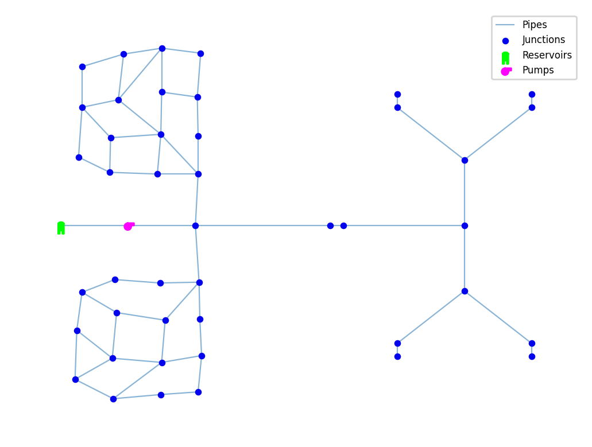

## Description
GraphLeak is a benchmark designed for leakage detection and localization research in water distribution networks. The benchmark provides EPANET models together with generated datasets containing pressure, flow, volume, leakage labels, and leak location information. The repository also includes MATLAB scripts and additional resources for reproducing and extending the data generation process. 

The network used in this benchmark contains 44 junctions, 59 pipes, one reservoir, and one pump. 

## How to use: 
The complete GraphLeak benchmark is available through the original repository: [information](https://github.com/gasiepgodoy/WDN-Models-and-Data-Sets/tree/main)

## Reference 
Tomazini, Lucas & Rolle, Rodrigo & Godoy, Eduardo & Colombini, Esther & Simões, Alexandre. (2024). GraphLeak: A Realistic Dataset for Analyzing Leaks in Water Distribution Systems. Congresso Brasileiro de Automática - CBA. 4. 10.20906/CBA2024/4655.  [<i class="bi bi-link"></i>](https://doi.org/10.20906/CBA2024/4655)

